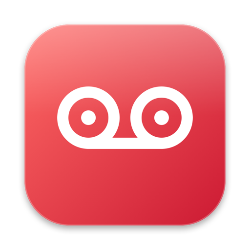
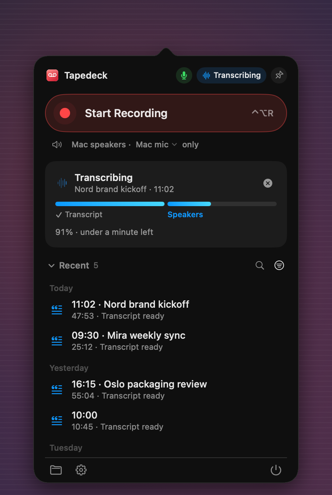
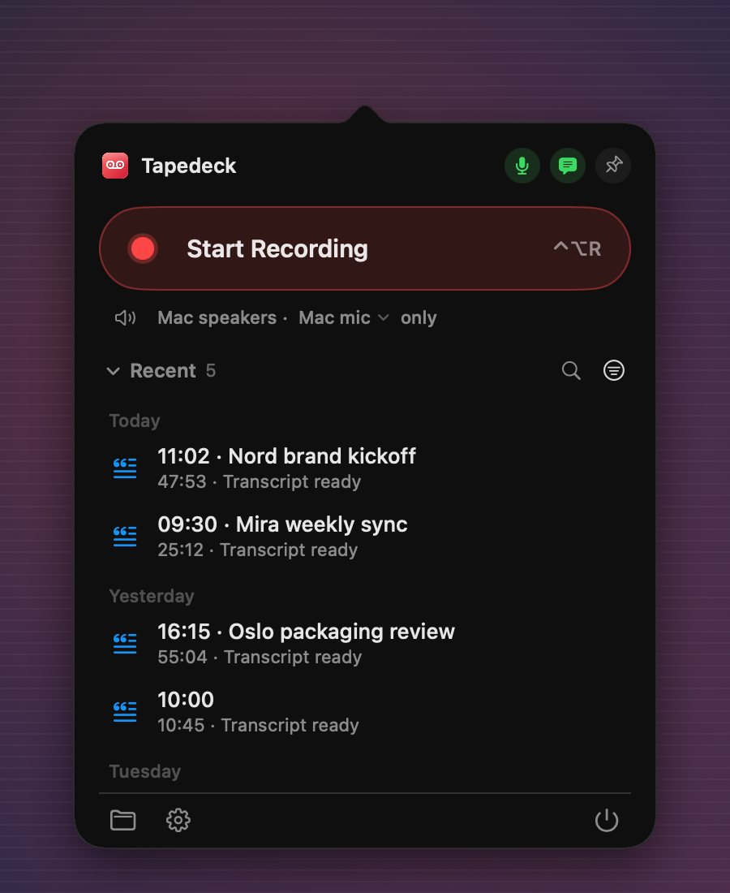

  

<h1 align="center">Tapedeck</h1>

  A tape recorder for your calls. 
  It lives in the menu bar, records both sides and writes the transcript on your Mac.

  <a href="https://github.com/ig0ra/tapedeck/releases/latest"><b>Download the latest version</b></a> 
  Free. macOS 14.2 or later, Apple Silicon.

  

Press <kbd>⌃</kbd><kbd>⌥</kbd><kbd>R</kbd> when the call starts and again when it ends. A few minutes later you have a transcript that says who said what, the audio, and a name from your calendar when there is one, in a folder you choose. Nothing leaves your Mac unless you turn on GitHub sync.

## Records both sides

Your microphone is always on tape. With headphones in, Tapedeck also records what your Mac plays into them, so the other side is recorded directly rather than through your mic. On speakers your mic already hears everyone, so it leaves that part out.

It records any call app. When Zoom, Teams, Slack, FaceTime, WhatsApp, Telegram, Discord, Webex or a browser (Google Meet and others) starts using the microphone, it offers to record.

## Notices the call for you

  

When a call app picks up the microphone, a small bar asks whether to record. A few minutes into the recording it asks how many people are on the call, so their voices can be told apart. Ignore either one and it goes away by itself.

## Transcribes on your Mac

<table>
  <tr>
    <td width="50%"></td>
    <td width="50%"></td>
  </tr>
</table>

Whisper turns the speech into text right on your Mac, in English, Ukrainian or Russian, or it detects the language for you. Then the voices are separated: with headphones you get "Me" and "Them" ("Them 1", "Them 2" when several people are on the other end), on speakers "Me", "Speaker 2", "Speaker 3". The call takes its name from your calendar or, on macOS 26 with Apple Intelligence on, from what was said. Otherwise it is named by the time.

Open the transcript as plain text, Markdown or PDF, or have it waiting on the clipboard when it is ready. If the voices came out wrong, tell Tapedeck how many people there were and it splits them again in under a minute, without transcribing anything twice.

## Stays out of the way

A small floating bar shows the time and two reels that turn with the voices. From there you can pause, add a note at the current moment, save without transcribing, or throw the recording away. Notes also have a shortcut, <kbd>⌃</kbd><kbd>⌥</kbd><kbd>N</kbd>; the others can be turned on in Settings. Forgot to stop? After 45 minutes it asks "Still on the call?", and if nobody answers and the call has been silent for 10 minutes, it saves the recording and stops.

After transcription the audio is compressed to about 14 MB an hour. After as many days as you choose (30 by default) it goes to the Trash; transcripts stay. A recording shorter than a few seconds, like a double press of the shortcut, is not kept.

## Settings

  

Pick the microphone. By default Tapedeck keeps using the Mac's own mic when your AirPods connect, so they keep their full sound quality; you can follow macOS instead or stick to one mic. Leave music and video apps out of the other side's track. Change the shortcuts, the questions, and the look of the recording card: there is a cassette, a tape deck, a reel-to-reel, a dictaphone and a few more.

## Privacy

Recording, transcription and speaker separation all happen on your Mac. There is no account, no server and no analytics.

Tapedeck goes online for three things only:

- to download the speech and speaker models once (about 650 MB, or 1.5 GB for the optional Accurate model);
- to check for updates;
- if you turn it on, to send transcripts (text, never audio) to a GitHub repository of your own.

## Install

1. Download the `.dmg` from [Releases](https://github.com/ig0ra/tapedeck/releases/latest) and drag Tapedeck to Applications.
2. Open it. Tapedeck is not notarized by Apple yet, so macOS says it cannot check the app: click **Done**, then go to **System Settings → Privacy & Security** and click **Open Anyway**. You only do this once.
3. A tape icon appears in the menu bar. When you record the first time, allow the microphone and, for headphones, System Audio Recording.

Tapedeck checks for a new version once a day and tells you what is new. Install it with one click, or turn on "Install updates without asking". Every update is checked against Tapedeck's signature first, and none is installed during a recording or a transcription.

## Requirements

A Mac with Apple Silicon (Intel Macs are not supported), macOS 14.2 or later and about 1 GB of free space. Calendar access is optional.

## Before you record

Laws about recording calls differ between countries. Let people know you are recording, and ask them when the law says you should.
