

  

<h1 align="center">Notetape</h1>

  <b>A tape recorder for your calls.</b> 
  It lives in the menu bar, records both sides and writes the transcript on your Mac.

Notetape was called Tapedeck until version 1.2.0. If you have Tapedeck, it updates itself to Notetape: your recordings, settings and permissions stay.

  
  
  
  

https://github.com/user-attachments/assets/2528bc18-3ad0-4d74-9ad6-5dc593a9908b

<!-- Teaser video: in GitHub's web editor, drag tapedeck-teaser.mp4 onto the empty line below.
     GitHub uploads it and puts a https://github.com/user-attachments/assets/… link there, which plays inline. -->

  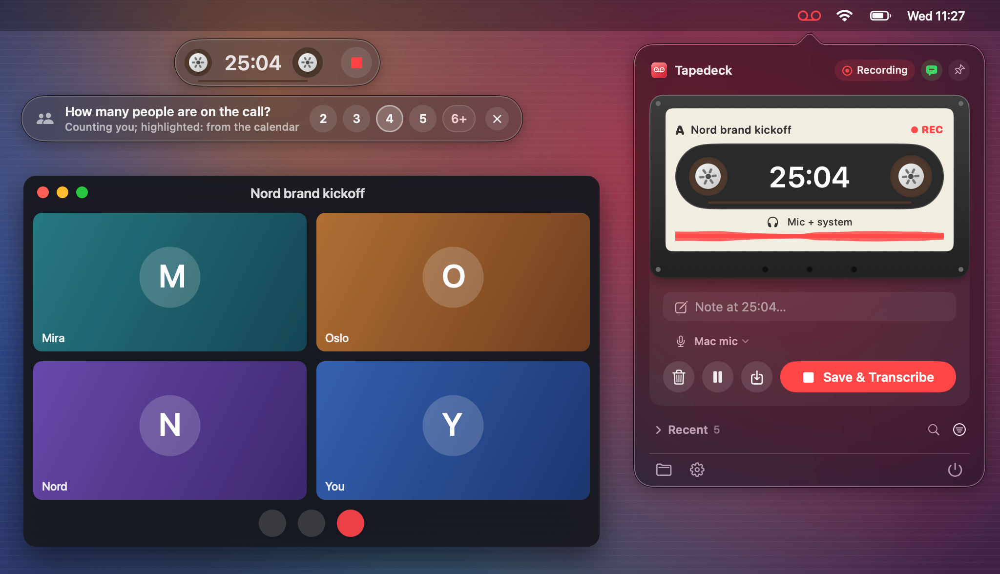

Press <kbd>⌃</kbd><kbd>⌥</kbd><kbd>R</kbd> when the call starts and again when it ends. A few minutes later you have a transcript that says who said what, the audio, and a name from your calendar when there is one, in a folder you choose. Nothing leaves your Mac unless you turn on GitHub sync.

<table>
  <tr>
    <td width="33%" valign="top">
      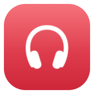 
      <b>Both sides of the call</b> 
      Your mic, and with headphones in, what your Mac plays into them.
    </td>
    <td width="33%" valign="top">
      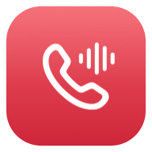 
      <b>Asks before it records</b> 
      When Zoom, Teams, Meet or another call app takes the mic.
    </td>
    <td width="33%" valign="top">
      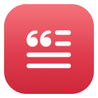 
      <b>Transcripts on your Mac</b> 
      Whisper, in English, Ukrainian or Russian. Text, Markdown or PDF.
    </td>
  </tr>
  <tr>
    <td valign="top">
      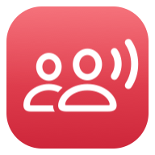 
      <b>Knows who spoke</b> 
      Separates the voices, and asks how many people there were.
    </td>
    <td valign="top">
      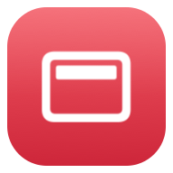 
      <b>Stays out of the way</b> 
      A small floating bar, notes with a shortcut, a pause button.
    </td>
    <td valign="top">
      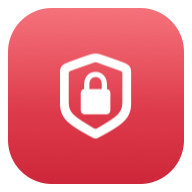 
      <b>No account, no cloud</b> 
      Recording, transcription and speakers all happen on your Mac.
    </td>
  </tr>
</table>

## Records both sides

Your microphone is always on tape. With headphones in, Notetape also records what your Mac plays into them, so the other side is recorded directly rather than through your mic. On speakers your mic already hears everyone, so it leaves that part out.

  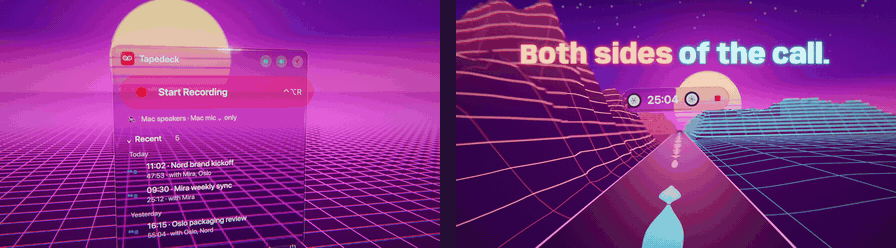

  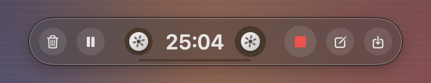

While you talk, a small glass bar sits at the top of the screen. The reels turn with the voices, so you can see it hears you. Discard, pause, add a note at this moment, save: it is all there, and the bar folds down to the reels and the time when you are not pointing at it.

## Notices the call for you

  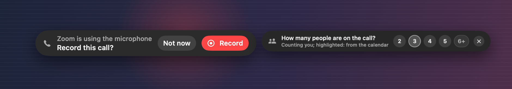

Notetape records any call app. When Zoom, Teams, Slack, FaceTime, WhatsApp, Telegram, Discord, Webex or a browser (Google Meet and others) starts using the microphone, a small bar asks whether to record. A few minutes into the recording it asks how many people are on the call, so their voices can be told apart. Ignore either one and it goes away by itself.

  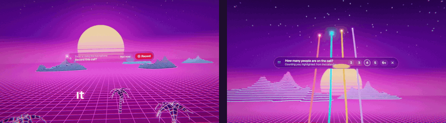

## Transcribes on your Mac

  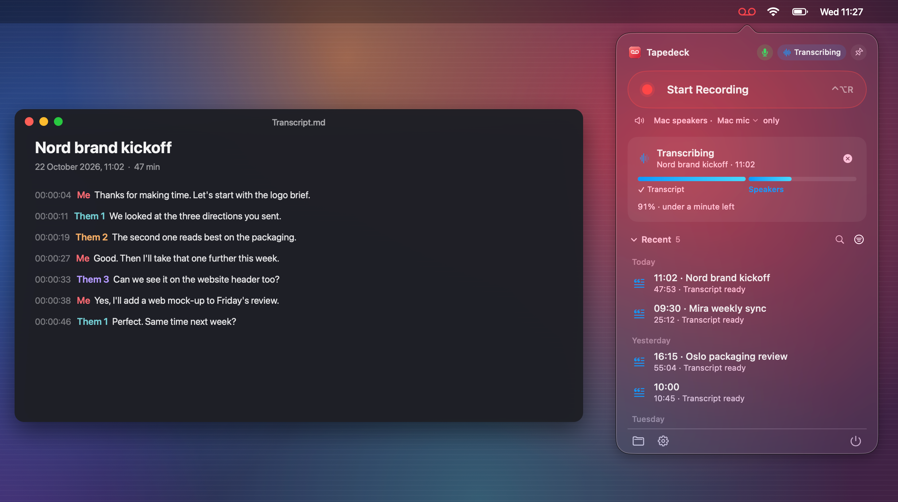

Whisper turns the speech into text right on your Mac, in English, Ukrainian or Russian, or it detects the language for you. Then the voices are separated: with headphones you get "Me" and "Them" ("Them 1", "Them 2" when several people are on the other end), on speakers "Me", "Speaker 2", "Speaker 3". The call takes its name from your calendar or, on macOS 26 with Apple Intelligence on, from what was said. Otherwise it is named by the time.

  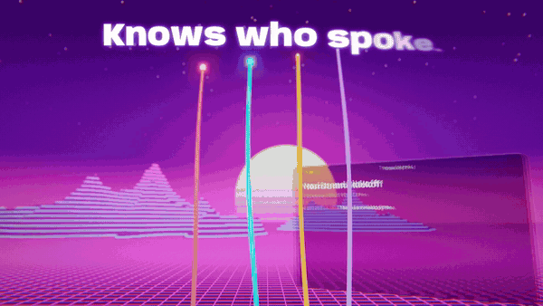

Open the transcript as plain text, Markdown or PDF, or have it waiting on the clipboard when it is ready. If the voices came out wrong, tell Notetape how many people there were and it splits them again in under a minute, without transcribing anything twice.

## Settings

  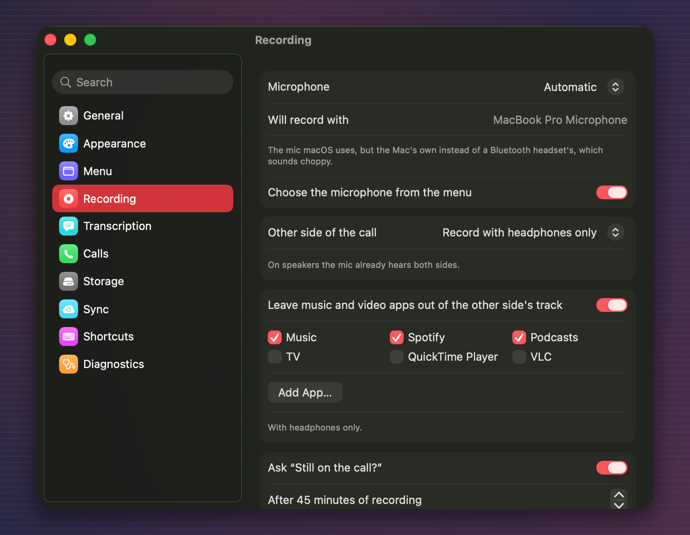

Pick the microphone. By default Notetape keeps using the Mac's own mic when your AirPods connect, so they keep their full sound quality; you can follow macOS instead or stick to one mic. Leave music and video apps out of the other side's track. Change the shortcuts, the questions, and the look of the recording card: there is a cassette, a tape deck, a reel-to-reel, a dictaphone and a few more.

  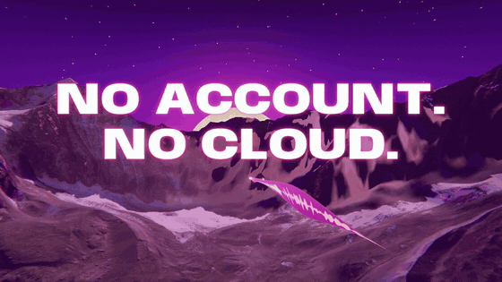

After transcription the audio is compressed to about 14 MB an hour. After as many days as you choose (30 by default) it goes to the Trash; transcripts stay. A recording shorter than a few seconds, like a double press of the shortcut, is not kept.

## Shortcuts

| Shortcut | What it does |
| --- | --- |
| <kbd>⌃</kbd><kbd>⌥</kbd><kbd>R</kbd> | Start recording, or stop and transcribe |
| <kbd>⌃</kbd><kbd>⌥</kbd><kbd>N</kbd> | Add a note at the current moment |
| Your choice | Pause, save without transcribing, discard: off until you set them in Settings |

## Privacy

Recording, transcription and speaker separation all happen on your Mac. There is no account, no server and no analytics.

  

Notetape goes online for three things only:

- to download the speech and speaker models once (about 650 MB, or 1.5 GB for the optional Accurate model);
- to check for updates;
- if you turn it on, to send transcripts (text, never audio) to a GitHub repository of your own.

## Install

1. Download the `.dmg` from [Releases](https://github.com/ig0ra/notetape/releases/latest) and drag Notetape to Applications.
2. Open it. Notetape is not notarized by Apple yet, so macOS says it cannot check the app: click **Done**, then go to **System Settings → Privacy & Security** and click **Open Anyway**. You only do this once.
3. A tape icon appears in the menu bar. When you record the first time, allow the microphone and, for headphones, System Audio Recording.

Notetape checks for a new version once a day and tells you what is new. Install it with one click, or turn on "Install updates without asking". Every update is checked against Notetape's signature first, and none is installed during a recording or a transcription.

**Requirements:** a Mac with Apple Silicon (Intel Macs are not supported), macOS 14.2 or later, about 1 GB of free space. Calendar access is optional.

## Questions

<b>Does it work with Google Meet and other calls in the browser?</b>

 
Yes. Notetape records the microphone and what your Mac plays, whatever app the call is in. It also offers to record when Chrome, Safari, Arc, Firefox, Edge, Brave, Opera or Vivaldi start using the microphone.

<b>Do I need headphones?</b>

 
No. On speakers your microphone hears both sides, and that is what gets recorded. Headphones give a cleaner recording of the other side and a clear "Me" and "Them" in the transcript.

<b>Where do my recordings go?</b>

 
Each call gets a folder in Documents → Notetape (Documents → Tapedeck if you updated from Tapedeck), named by its date and title, with the transcript and the audio. You can choose another folder in Settings.

<b>Why does macOS say it cannot check the app?</b>

 
Notetape is signed but not notarized by Apple yet. Use <b>Open Anyway</b> in System Settings → Privacy & Security once; updates after that install without the question.

<b>Is it legal to record calls?</b>

 
Laws about recording calls differ between countries. Let people know you are recording, and ask them when the law says you should.

